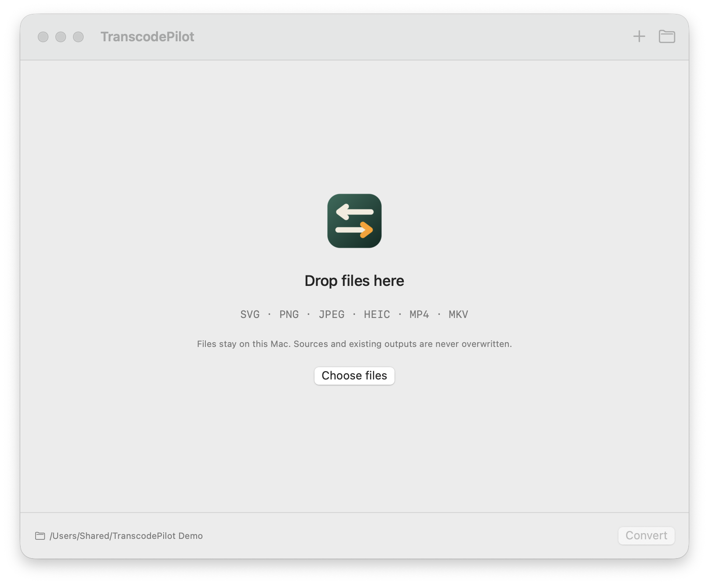

# TranscodePilot

PilotFoundry による macOS ローカル画像/音声変換ツール。バージョン
**0.1.0 — 開発プレビュー**。

[English](README.md) · [简体中文](README.zh-Hans.md) · [繁體中文](README.zh-Hant.md)



## 対応変換

- 静的で自己完結した SVG → PNG/JPEG。
- PNG/JPEG/HEIC → PNG/JPEG（比率を保って縮小・拡大）。
- MP4/MKV → MP3（最初の音声トラック）。
- バッチキュー、ファイルごとの設定、同種ファイルへの適用、キャンセル/再試行、
  結果プレビューと Finder 表示。
- 日本語、English、简体中文、繁體中文。

## ビルド

macOS 14+、Swift 6、ローカルの変換エンジンが必要です:

```sh
brew install ffmpeg librsvg
make doctor
make check
make app
```

現在は Apple Silicon macOS 27 のみで検証済みです。Intel/macOS 14 は未検証です。
本アプリはローカル ad-hoc プレビュー版で、公証されていません。変換エンジンは
同梱されません。

## 境界

ファイルはこの Mac 内でのみ処理されます。ソースは削除せず、既存の出力は上書き
しません。SVG のスクリプト、アニメーション、外部リソースは拒否されますが、SVG
検証は汎用サンドボックスではありません。出力ボリュームはハードリンク対応
（APFS など）が必要です。

詳細: [製品原則](docs/CORE.md) · [デザイン](docs/DESIGN.md) · [テスト](docs/TESTING.md) ·
[リリース](docs/RELEASE.md) · [コントリビューション](CONTRIBUTING.md) · [セキュリティ](SECURITY.md)
