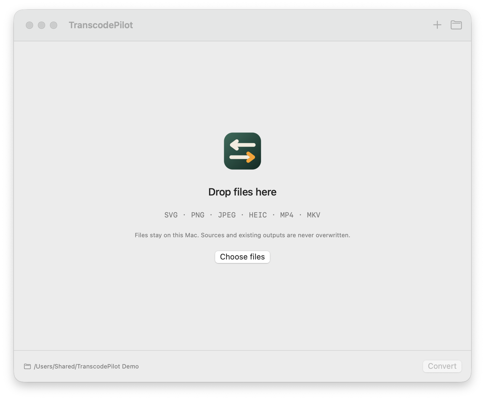
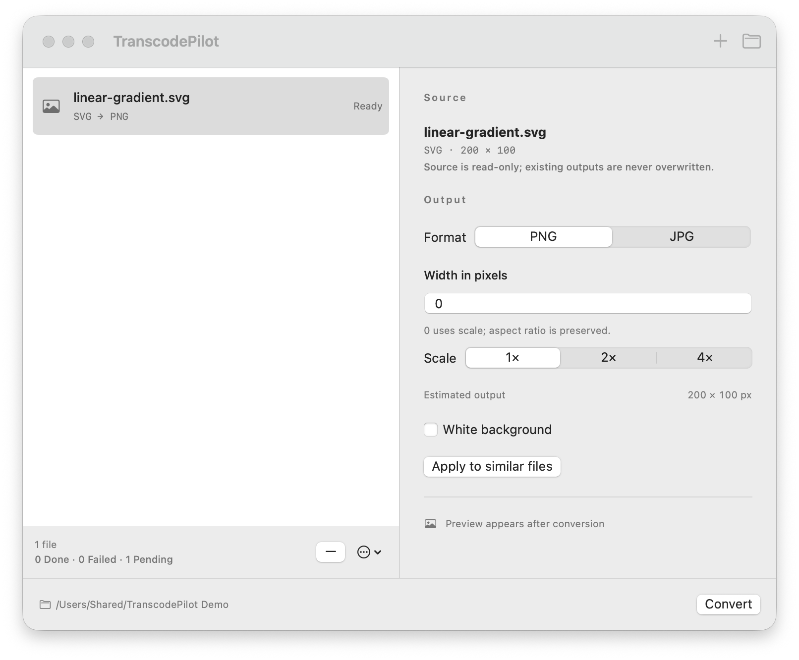

# TranscodePilot

Local image and audio conversion for macOS, by **PilotFoundry**.
Version **0.1.0 — development preview**. Independent of SwitchPilot.

[简体中文](README.zh-Hans.md) · [繁體中文](README.zh-Hant.md) · [日本語](README.ja.md)





## Supported conversions

- Static, self-contained SVG → PNG / JPEG, rendered at the requested pixel size.
- PNG / JPEG / HEIC → PNG / JPEG, with proportional resizing.
- MP4 / MKV → MP3 (128 / 192 / 320 kbps); first audio track only.
- Batch queue, per-file settings, apply-to-similar, cancel/retry, output previews
  for images and Finder reveal. No source deletion or output overwrite.
- English, 简体中文, 繁體中文, 日本語; follows system language.

## Build and run

Requires macOS 14+, Swift 6 and Apple Command Line Tools or Xcode. The current
development preview has only been exercised on Apple Silicon macOS 27; macOS 14 and
Intel are not yet validated and are not support claims. This build requires local
conversion tools:

```sh
brew install ffmpeg librsvg
make doctor
make check
make run
```

The build is `.build/TranscodePilot.app`, ad-hoc signed, not notarized. A local
preview package can be produced with `make package`
(`.build/release/TranscodePilot-<version>-<arch>.zip` plus SHA256). No public
standalone release is provided; engine binaries are not bundled.

Drop files, select an output format, choose a folder, then Convert (⌘↩).
⌘O adds files. Width 0 uses 1×/2×/4×; otherwise width is in actual pixels.
SVG sizing: px and physical units use a 96 dpi reference; percentages need a
viewBox; an explicit width is exact and height follows the intrinsic aspect ratio.
Invalid widths or output limits are shown inline and Convert stays disabled
while a pending file is invalid. The inspector shows estimated output dimensions.
JPEG fills transparent areas white. Image outputs use 8-bit sRGB.
Successful tasks stay in the current queue; change settings to convert again.
Images start at 1× and SVG/video at 2× unless a scale is saved; width and other
settings are saved locally. Files added during a conversion join the next run.
Settings and the last output folder are saved locally; the queue is session-only.
Quitting during conversion cancels the active task, waits briefly for cleanup,
then quits; the window cannot be closed while a conversion is running.

## Boundaries

- No application network requests, accounts, telemetry or background service.
- SVG dimension rules: physical units are converted at 96 dpi, percentages
  require a viewBox, and missing one dimension derives from the viewBox aspect.
  SVGs with neither dimensions nor a viewBox are rejected.
- SVG scripts, animation, HTML (`foreignObject`), linked/embedded resources,
  external CSS and XML entities are rejected. Fonts use installed system fonts;
  missing fonts can substitute. Convert text to paths for exact typography.
- Images: 40 MP output, 80 MP bitmap input, 16,384 maximum output dimension.
- MP3 conversion reports real FFmpeg progress; bitmap/SVG conversion reports stage progress (rendering/decoding/encoding/verification) with a determinate bar. No fabricated percent.
  Stale conversion temp directories older than 24 hours are cleaned at launch.
  Disk space is checked before encoding; source size/mtime is rechecked before
  publication so external mutations cannot silently publish a stale result.
- Image preview is the actual exported result, available after conversion.
- Existing output names get `-1`, `-2`, etc. Atomic publication uses hard links;
  the output folder is checked before conversion and volumes without hard-link
  support (e.g. FAT/exFAT) are rejected. Network-volume behavior still needs
  real-device acceptance.
- SVG validation is a coarse local policy, not a general renderer sandbox; the
  SVG renderer runs as a separate local process.
- JPEG/PNG output does not preserve EXIF, GPS, HDR, animation or original profiles.
- App-owned errors are localized with recovery actions (retry / choose another output folder); engine details may remain in English.

See [product principles](docs/CORE.md), [design direction](docs/DESIGN.md),
[checks](docs/TESTING.md), [implementation checklist](docs/IMPLEMENTATION.md),
[release engineering](docs/RELEASE.md), [changelog](CHANGELOG.md),
[contributing](CONTRIBUTING.md), [security](SECURITY.md) and [support](SUPPORT.md).

## Engines and licensing

Application source is MIT. ImageIO is a system framework. FFmpeg and librsvg are
separately installed external tools with their own licenses. Homebrew FFmpeg here
is GPL-enabled; do not treat its dependencies as covered by this app's MIT license.
Standalone distribution needs an audited engine build, dependency/license notices,
architecture verification, signing and release acceptance before publication.
