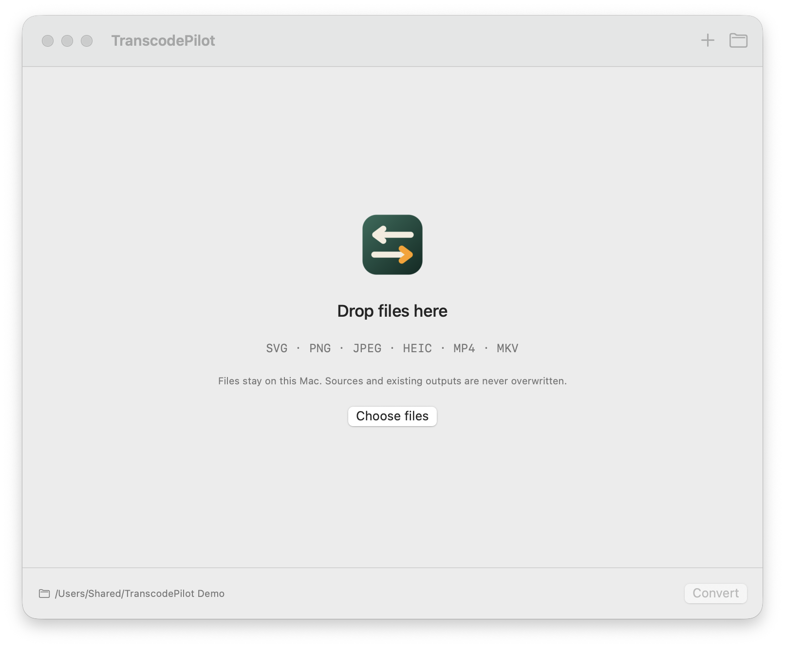

# TranscodePilot

PilotFoundry 出品的 macOS 本地图片/音频转换工具。版本 **0.1.0 — 开发预览**。

[English](README.md) · [繁體中文](README.zh-Hant.md) · [日本語](README.ja.md)



## 支持的转换

- 静态、自包含 SVG → PNG/JPEG。
- PNG/JPEG/HEIC → PNG/JPEG，可等比缩放。
- MP4/MKV → MP3，取首条音轨。
- 批量队列、每文件设置、应用到同类文件、取消/重试、结果预览与 Finder 显示。
- 简体中文、繁體中文、日本語、English。

## 构建

需要 macOS 14+、Swift 6 和本地转换引擎：

```sh
brew install ffmpeg librsvg
make doctor
make check
make app
```

当前只在 Apple Silicon macOS 27 上验证；尚未验证 Intel/macOS 14。应用为本地
ad-hoc 预览版，未公证，转换引擎不随应用打包。

## 边界

文件只在本机处理；不删除源文件、不覆盖已有输出。SVG 的脚本、动画、外部资源
会被拒绝；SVG 校验不是通用沙箱。输出卷必须支持硬链接（如 APFS）。

更多：[产品原则](docs/CORE.md) · [设计](docs/DESIGN.md) · [测试](docs/TESTING.md) ·
[发布](docs/RELEASE.md) · [贡献](CONTRIBUTING.md) · [安全](SECURITY.md)
