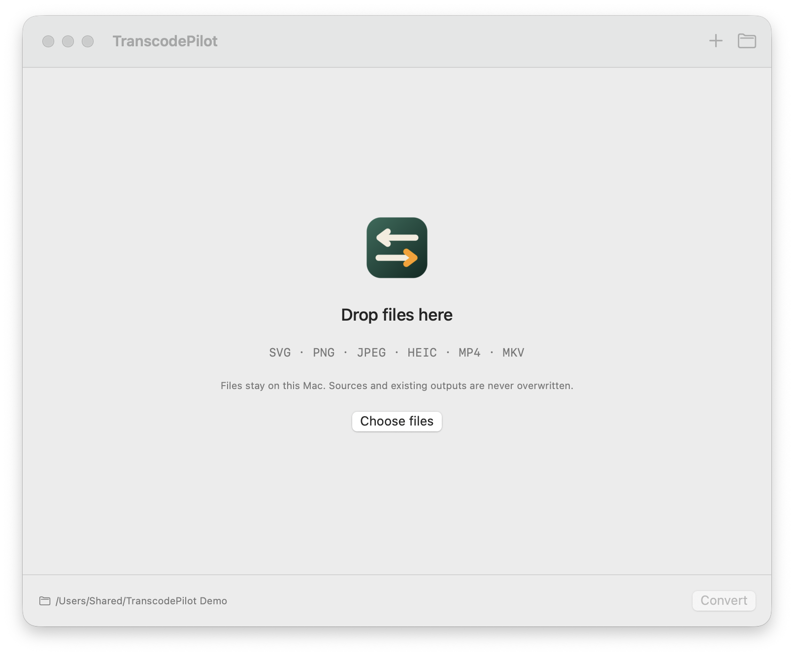

# TranscodePilot

PilotFoundry 的 macOS 本機影像/音訊轉換工具。版本 **0.1.0 — 開發預覽**。

[English](README.md) · [简体中文](README.zh-Hans.md) · [日本語](README.ja.md)



## 支援的轉換

- 靜態、自包含 SVG → PNG/JPEG。
- PNG/JPEG/HEIC → PNG/JPEG，可等比例縮放。
- MP4/MKV → MP3，取第一條音軌。
- 批次佇列、逐檔設定、套用到同類檔案、取消/重試、結果預覽與 Finder 顯示。
- 繁體中文、简体中文、日本語、English。

## 建置

需要 macOS 14+、Swift 6 與本機轉換引擎：

```sh
brew install ffmpeg librsvg
make doctor
make check
make app
```

目前僅在 Apple Silicon macOS 27 驗證；尚未驗證 Intel/macOS 14。應用為本機
ad-hoc 預覽版，未公證，轉換引擎不隨應用打包。

## 邊界

檔案只在本機處理；不刪除來源、不覆寫既有輸出。SVG 腳本、動畫、外部資源會被
拒絕；SVG 驗證不是通用沙箱。輸出卷必須支援硬連結（例如 APFS）。

更多：[產品原則](docs/CORE.md) · [設計](docs/DESIGN.md) · [測試](docs/TESTING.md) ·
[發佈](docs/RELEASE.md) · [貢獻](CONTRIBUTING.md) · [安全](SECURITY.md)
